<picture>
  <source media="(prefers-reduced-motion: reduce) and (prefers-color-scheme: dark)" srcset="assets/header-still-dark.svg">
  <source media="(prefers-reduced-motion: reduce)" srcset="assets/header-still-light.svg">
  <source media="(prefers-color-scheme: dark)" srcset="assets/header-dark.svg">
  <source media="(prefers-color-scheme: light)" srcset="assets/header-light.svg">
  
</picture>

### 市川 和輝 · Pepper161

**Computer Science student at the University of Nottingham Malaysia · Graduating July 2027**

I build web products and work on the people and processes that keep them running.
My interests span software development, team collaboration, and turning real problems into workable solutions.

マレーシアでComputer Scienceを学びながら、Webサービスの開発・運営に取り組んでいます。
利用者の困りごとを捉えて仕組みにすることと、周囲が力を発揮できる進め方を考えることに関心があります。

[Projects](#selected-projects) · [Technologies](#technologies) · [Activity](#github-activity) · [Current focus](#current-focus)

## Selected projects

### 01　Kopi Chat

**マレーシアの日本人学生が、大学を越えて情報交換できるコミュニティ。**

- **開発**：認証機能・管理者機能を担当。大学メールを使えない学生向けに、一般メールと学生証等による代替認証を提案・実装しました。
- **運営**：その後はエンジニアチームの運営を引き継ぎ、情報共有や進捗確認の進め方を見直しました。
- **現在**：モバイルアプリのバグ修正と、後輩への開発の引継ぎ・育成に取り組んでいます。

`Next.js` `TypeScript` `Firebase`

**[Visit Kopi Chat ↗](https://kopi-chat.com/)**

### 02　Locipe

**見慣れない食材の写真から、その土地の料理を見つけるレシピアプリ。**

設計からフルスタック実装に取り組んでいます。
AIによる食材の識別とレシピの提案を組み合わせ、機能だけでなく、運用費用や保守のしやすさも考えながら開発しています。

`Next.js` `TypeScript` `PostgreSQL` `Prisma` `Gemini API`

**[Explore the repository ↗](https://github.com/Pepper161/locipe)**

### 03　EmotiGift

**SNS投稿やチャットを手がかりに、相手へのプレゼントを提案するアプリ。**

ハッカソンで取り組んだプロジェクトです。概要、セットアップ手順、デモ動画、発表資料をリポジトリにまとめています。

`React` `TypeScript` `FastAPI` `Python` `Gemini API`

**[Explore the project ↗](https://github.com/Pepper161/supporterz-hackathon)**

## Technologies

開発で使用・学習してきた技術です。プロジェクトごとの構成や使い方は、各リポジトリで紹介しています。

- **Web development** — TypeScript / JavaScript, React, Next.js, Node.js
- **Data & infrastructure** — Firebase / Firestore, PostgreSQL, Prisma, Vercel
- **University & tooling** — Python, Java, C, Git / GitHub

## GitHub activity

<picture>
  <source media="(prefers-color-scheme: dark)" srcset="https://github-profile-summary-cards.vercel.app/api/cards/profile-details?username=Pepper161&amp;theme=github_dark">
  <source media="(prefers-color-scheme: light)" srcset="https://github-profile-summary-cards.vercel.app/api/cards/profile-details?username=Pepper161&amp;theme=github">
  
</picture>

Live card by <a href="https://github.com/vn7n24fzkq/github-profile-summary-cards">GitHub Profile Summary Cards</a>

## Current focus

- **Development & handover** — Kopi Chatの改善と、後輩が開発を進めるための資料・手順の整備。
- **Final-year research** — AI生成コードの修正に渡す情報と、コードの正しさ・処理負担の関係を調べる研究。
- **Career interests** — 技術と開発経験を生かし、課題の特定から実行・定着まで関わるコンサルティング。

University of Nottingham Malaysia · BSc (Hons) Computer Science · Expected July 2027 
Made with <a href="https://github.com/patch-gg/pixelfx">pixelfx</a>, <a href="https://github.com/showheyohtaki/motion-prompt">Motion Prompt</a> and <a href="https://github.com/tandpfun/skill-icons">Skill Icons</a> · <a href="ASSETS.md">Credits and licenses</a>
